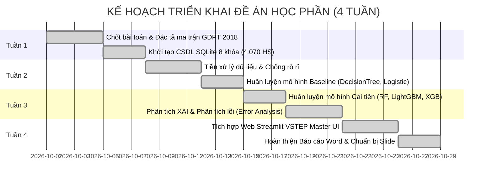

# ĐỀ CƯƠNG CHI TIẾT ĐỀ TÀI HỌC PHẦN
## CHƯƠNG TRÌNH ĐÀO TẠO CAO HỌC CÔNG NGHỆ THÔNG TIN - LỚP K20.2
**Học phần:** Các Hệ Cơ Sở Tri Thức  
**Hình thức:** Nhóm 2 - 4 học viên  
**Thời gian thực hiện:** 4 tuần  

---

### 1. TÊN ĐỀ TÀI
**"Nghiên Cứu Hệ Tri Thức Và Học Máy Hỗ Trợ Phân Tích Ma Trận Kết Quả Đánh Giá, Cảnh Báo Sớm Nguy Cơ Học Tập Môn Tin Học THPT Định Hướng Thi Tốt Nghiệp Chương Trình GDPT 2018"**

---

### 2. MỤC TIÊU VÀ PHẠM VI NGHIÊN CỨU

#### 2.1. Mục tiêu cụ thể:
1. **Thiết kế và mô hình hóa bài toán**: Xây dựng bài toán phân loại đa lớp có mất cân bằng nhãn (Imbalanced Multi-class Classification) để phân loại 3 mức nguy cơ học tập môn Tin học: *An toàn ($\ge 6.5$)*, *Cần theo dõi ($5.0 - 6.4$)*, và *Nguy cơ cao ($< 5.0$ / dính điểm liệt)*.
2. **Khai phá & Tiền xử lý dữ liệu chống rò rỉ (Anti-Leakage Pipeline)**: Chuẩn hóa 15 thuộc tính ma trận đánh giá kết hợp giữa thang điểm THPT truyền thống và các chỉ số năng lực GDPT 2018 (4 mức Bloom, 3 mạch tri thức CS/ICT/DL). Phân chia tập độc lập Stratified Split (Train 70% - Val 15% - Test 15%).
3. **Thực nghiệm đa mô hình (Baseline vs Improved)**: Xây dựng ít nhất 2 mô hình cơ sở (*Logistic Regression*, *Decision Tree*) và 3 mô hình cải tiến (*Random Forest*, *LightGBM*, *XGBoost*). Đánh giá toàn diện trên tập kiểm thử tách biệt với các chỉ số học thuật: Accuracy, Macro F1, Recall/Precision lớp Nguy cơ cao, và Độ trễ suy luận (ms).
4. **Giải thích mô hình (Explainable AI - XAI)**: Tích hợp phương pháp Permutation Importance và suy diễn thuộc tính giúp giáo viên thấy rõ căn cứ tại sao một học sinh bị cảnh báo nguy cơ.
5. **Phân tích lỗi chuyên sâu (In-Depth Error Analysis)**: Mổ xẻ 69 ca dự đoán sai trên tập Test (False Negatives & False Positives), rút ra các đúc kết sư phạm có giá trị.
6. **Hiện thực hóa nguyên mẫu phần mềm (Web Prototype)**: Xây dựng ứng dụng hoàn chỉnh bằng Python Streamlit (theo ngôn ngữ thiết kế VSTEP Master UI Standard) có CSDL nhúng SQLite (4.070 học sinh qua 8 khóa), hỗ trợ tải file Excel mới, cảnh báo dữ liệu không hợp lệ, và tự động lập kịch bản phân bổ lớp phụ đạo.

#### 2.2. Đối tượng & Phạm vi sử dụng:
- **Người dùng đích:** Ban Giám hiệu, Tổ chuyên môn Tin học và Giáo viên bộ môn tại các trường THPT.
- **Giới hạn hệ thống (System Limitations):** Hệ thống đóng vai trò **Hỗ trợ ra quyết định (Decision Support System)**, tuyệt đối không tự động thay đổi học bạ hay thay thế quyền đánh giá chuyên môn của thầy cô giáo.

---

### 3. ĐẶC TẢ BIẾN ĐẦU VÀO VÀ ĐẦU RA

| Nhóm thuộc tính | Tên biến | Kiểu dữ liệu | Ý nghĩa sư phạm & GDPT 2018 |
|---|---|---|---|
| **Đánh giá quá trình THPT** | `score_mieng` `score_15p` `score_45p` `score_hk1` `score_hk2` | Float [0, 10] | 5 cột điểm đánh giá thường xuyên và định kỳ truyền thống của học sinh THPT. |
| **Tổng hợp quá trình** | `score_tx_avg` `score_trend` | Float [0, 10] Float [-10, 10] | `TB Quá Trình` = $(Miệng + 15p + 45p \times 2) / 4$ `Xu Hướng` = $HK2 - HK1$ (Đo mức độ tiến bộ/tụt dốc). |
| **Chuyên cần số** | `homework_ratio` | Float [0, 1] | Tỷ lệ hoàn thành các bài tập rèn luyện trên LMS trường học. |
| **4 Cấp độ tư duy Bloom** | `score_recall` `score_understand` `score_apply` `score_high_apply` | Float [0, 10] | Điểm thành phần tương ứng: Nhận biết, Thông hiểu, Vận dụng, Vận dụng cao. |
| **3 Mạch nội dung Tin học** | `score_topic_cs` `score_topic_ict` `score_topic_dl` | Float [0, 10] | • CS: Khoa học máy tính & Thuật toán/Lập trình • ICT: Tin học ứng dụng & CSDL • DL: Đạo đức, pháp luật & Văn hóa số. |
| **Biến mục tiêu (Output)** | `target_risk_level` `risk_label` | Integer {0, 1, 2} String | **0: An toàn** ($\ge 6.5$ điểm) **1: Cần theo dõi** ($5.0 - 6.4$ điểm) **2: Nguy cơ cao** ($< 5.0$ điểm hoặc dính điểm liệt). |

---

### 4. NGUỒN DỮ LIỆU & KIỂM SOÁT RÒ RỈ (ANTI-LEAKAGE)

- **Quy mô:** **4.070 học sinh** thuộc **8 khóa đào tạo** (K18 đến K25), lưu trữ bền vững trong CSDL nhúng SQLite (`data/vstep_informatics.db`) và xuất bản kèm file Excel chuẩn `du_lieu_8_khoa_tin_hoc_thpt.xlsx`.
- **Nguồn gốc:** ⚠️ DỮ LIỆU GIẢ LẬP – mô phỏng dựa trên phân phối chuẩn đa biến (Multivariate Distribution) bám sát phổ điểm đề thi minh họa của Bộ GD&ĐT theo Chương trình GDPT 2018.
- **Bảo mật:** Toàn bộ thông tin cá nhân được ẩn danh hóa nghiêm ngặt (`STU_xxxx`), không lưu trữ CCCD hay dữ liệu nhạy cảm.
- **Chia tập dữ liệu:** Phân tầng có bảo toàn tỷ lệ nhãn (Stratified Split):
  - **Train Set (70%):** 2.849 mẫu (dùng để khớp mô hình và fit bộ tiền xử lý).
  - **Validation Set (15%):** 610 mẫu (dùng để tinh chỉnh siêu tham số).
  - **Test Set (15%):** 611 mẫu (tập kiểm thử độc lập, hoàn toàn tách biệt, dùng để đánh giá cuối cùng).

---

### 5. KẾ HOẠCH TRIỂN KHAI 4 TUẦN & PHÂN CÔNG ĐÓNG GÓP (NHÓM 4 HỌC VIÊN)

#### Ma trận phân công đóng góp thành viên:
| Học viên | Vai trò | Nhiệm vụ chi tiết | Mức độ hoàn thành |
|---|---|---|:---:|
| **Học viên 1** | Trưởng nhóm | • Chủ trì đặc tả bài toán, thiết kế CSDL SQLite nhúng. • Xây dựng pipeline tiền xử lý và chia tập chống rò rỉ dữ liệu. • Huấn luyện và đánh giá các mô hình cơ sở (Baseline). | **100%** |
| **Học viên 2** | Thành viên ML | • Nghiên cứu và huấn luyện các mô hình cải tiến (Random Forest, LightGBM, XGBoost). • Tối ưu siêu tham số, xây dựng ma trận nhầm lẫn và đối sánh đa chỉ số. • Phân tích độ quan trọng thuộc tính Permutation Importance. | **100%** |
| **Học viên 3** | Kỹ sư Phần mềm | • Phát triển nguyên mẫu ứng dụng Web Streamlit theo chuẩn VSTEP Master UI. • Tích hợp biểu đồ Radar ma trận năng lực và biểu đồ XAI đóng góp rủi ro. • Lập trình thuật toán kịch bản phân bổ nguồn lực ôn tập phụ đạo (Tab 3). | **100%** |
| **Học viên 4** | Phân tích viên | • Thực hiện phân tích chuyên sâu các ca dự đoán sai (False Negatives & False Positives). • Đo đạc so sánh baseline thời gian vận hành giữa giáo viên thủ công và ML. • Xây dựng khung đạo đức AI và chấp bút hoàn thiện Báo cáo Word/LaTeX. | **100%** |

---

### 6. KẾT QUẢ THỰC NGHIỆM (DỮ LIỆU GIẢ LẬP)

> Số liệu lấy từ `models_saved/benchmark_results.csv`. Chỉ chứng minh tính khả thi của quy trình, không khẳng định hiệu quả thực tế.

#### 6.1. So sánh các mô hình (Tập Test: 611 mẫu)
| STT | Mô hình | Accuracy | Macro F1 | Recall (Nguy cơ cao) | Precision (Nguy cơ cao) |
|:---:|---|:---:|:---:|:---:|:---:|
| 1 | Baseline: Rule-Based Heuristic | 84.12% | 82.83% | 78.78% | 97.47% |
| 2 | Baseline: Decision Tree | 85.60% | 84.31% | 87.35% | 94.69% |
| 3 | **Baseline: Logistic Regression** | **90.34%** | **89.19%** | 91.84% | 95.74% |
| 4 | Improved: Random Forest | 88.71% | 87.31% | 91.02% | 94.89% |
| 5 | Improved: XGBoost | 88.38% | 86.64% | 91.84% | 92.98% |
| 6 | **Improved: LightGBM** | 89.36% | 87.72% | **93.88%** | 93.12% |

- Logistic Regression có Macro F1 cao nhất (dữ liệu giả lập gần tuyến tính).
- LightGBM có Recall lớp Nguy cơ cao tốt nhất – chỉ số ưu tiên về mặt sư phạm.

#### 6.2. So sánh thời gian (yêu cầu đề bài)
- **Mô hình (đo thực tế):** 4.070 học sinh trong ~0,02 s (Logistic) đến ~0,18 s (Random Forest).
- **Thủ công (giả định ước lượng, chưa khảo sát):** ~25–35 phút/lớp 40 học sinh.

#### 6.3. Phân tích lỗi (Random Forest – 69/611 ca sai, Accuracy 88,71%)
- **22 ca Nguy cơ cao → Cần theo dõi (bỏ sót):** điểm quá trình khá nhưng mạch CS / Vận dụng cao thấp.
- **22 ca An toàn → Cần theo dõi (cảnh báo nhầm):** thiếu điểm 15 phút hoặc tỷ lệ BTVN thấp.
- **25 ca lệch biên:** 13 ca Cần theo dõi → An toàn, 12 ca Cần theo dõi → Nguy cơ cao.
- Không có ca nào nhầm Nguy cơ cao ↔ An toàn.

---

### 7. DANH MỤC SẢN PHẨM BÀN GIAO ĐẦY ĐỦ
1. **Báo cáo toàn văn (.docx):** [`reports/Bao_Cao_Tong_Ket_Cac_He_CS_Tri_Thuc_K20.2.docx`](reports/Bao_Cao_Tong_Ket_Cac_He_CS_Tri_Thuc_K20.2.docx) (Đầy đủ 5 chương, bảng số liệu, biểu đồ minh họa và bìa chuẩn).
2. **Mã nguồn ứng dụng (.py):** [`app/app.py`](app/app.py) (Khởi chạy bằng `run_app.bat` hoặc lệnh `streamlit run app/app.py`).
3. **Cơ sở dữ liệu SQLite (.db):** [`data/vstep_informatics.db`](data/vstep_informatics.db) (4.070 học sinh, 8 khóa).
4. **Trọng số các mô hình đã huấn luyện (.joblib):** Thư mục [`models_saved/`](models_saved).
5. **Dữ liệu nghiên cứu Excel (.xlsx):** `du_lieu_8_khoa_tin_hoc_thpt.xlsx`.
